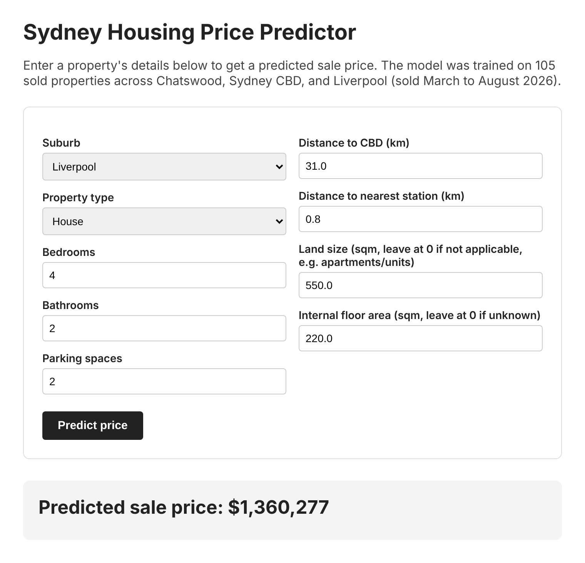
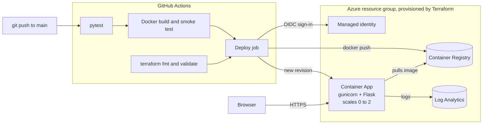

# Sydney Housing Price Predictor

[](https://github.com/rohitbondala277/Sydney-Housing/actions/workflows/ci-cd.yml)

An end-to-end machine learning project that predicts the sale price of residential properties in Sydney CBD, Chatswood and Liverpool. The trained model is served through a Flask web app, packaged with Docker and deployed to **Azure Container Apps** using **Terraform** and a **GitHub Actions** pipeline.

The model was developed as part of SIT720 Machine Learning at Deakin University, and the cloud deployment was built on top of it. No suitable public dataset existed, so the training data was collected manually from public property listings.



## Architecture



**Key design choices**

- **Passwordless deployment.** GitHub Actions signs in to Azure with OpenID Connect and a user-assigned managed identity. There are no client secrets in the repo or in GitHub.
- **Least privilege.** The pipeline identity can only push to this registry and manage this resource group. The running app has a separate identity that can only pull images.
- **Scale to zero.** The Container App scales down to zero replicas when idle, so it costs almost nothing when nobody is using it.
- **Health checks everywhere.** The `/health` endpoint is used by the Docker `HEALTHCHECK`, the Container Apps liveness and readiness probes, and the post-deploy check in the pipeline.
- **Reproducible model loading.** scikit-learn is pinned to the version the model was trained with, and a test fails the build if the model ever loads with a version mismatch.

## Repository contents

| Path | Purpose |
|---|---|
| `housing_price_model.ipynb` | Full ML workflow: data cleaning, exploratory analysis, feature engineering, model comparison and error analysis |
| `app.py`, `templates/` | Flask app serving predictions, plus a `/health` endpoint |
| `housing_model_bundle.pkl` | Trained Random Forest model and the lookup values used for imputation |
| `Dockerfile` | Production image: Python 3.13 slim, gunicorn, non-root user, health check |
| `tests/` | pytest smoke tests run on every push |
| `infra/` | Terraform for all Azure resources |
| `.github/workflows/ci-cd.yml` | CI/CD pipeline |

## The model

105 sold properties (35 per suburb), sold between March and August 2026. Features include suburb, property type, bedrooms, bathrooms, parking spaces, land size, internal floor area, distance to the CBD and distance to the nearest station. Missing floor areas are imputed from the median for the same suburb and property type, and the app applies the same fallback so training and inference stay consistent.

| Model | CV R² | CV MAE |
|---|---|---|
| Linear Regression | 0.579 | $423k |
| Random Forest | **0.627** | $393k |
| Gradient Boosting | 0.623 | $392k |

Random Forest (5-fold cross validation) is the model used in the app. Error remains high given the small dataset. The largest misses were high-value Chatswood houses with imputed floor areas, which points to data coverage rather than model choice as the main limitation. The notebook also compares the model against human and LLM price estimates on held-out properties.

## Run locally

```bash
git clone https://github.com/rohitbondala277/Sydney-Housing.git
cd Sydney-Housing
python -m venv venv
source venv/bin/activate      # Windows: venv\Scripts\activate
pip install -r requirements.txt
python app.py                 # http://localhost:5000
```

Or with Docker:

```bash
docker build -t sydney-housing .
docker run -p 8000:8000 sydney-housing   # http://localhost:8000
```

Run the tests with `pip install -r requirements-dev.txt && pytest`.

## Deploy to Azure

Needs an Azure subscription, the [Azure CLI](https://learn.microsoft.com/cli/azure/install-azure-cli) and [Terraform](https://developer.hashicorp.com/terraform/install) 1.6 or later.

**1. Provision the infrastructure**

```bash
az login
cd infra
cp terraform.tfvars.example terraform.tfvars   # add your subscription ID
terraform init
terraform apply
```

This creates the resource group, container registry, Log Analytics workspace, Container Apps environment and the GitHub deployment identity. The app itself is not created yet because there is no image in the registry.

**2. Connect GitHub to Azure**

Run `terraform output github_variables` and add each value as a repository variable under **Settings > Secrets and variables > Actions > Variables**. These are identifiers, not secrets.

**3. Push the first image**

Push to `main`, or open the **Actions** tab and run the CI/CD workflow manually. The deploy job builds the image and pushes it to the registry.

**4. Create the app**

Set `deploy_app = true` in `terraform.tfvars` and run `terraform apply` again. `terraform output app_url` prints the public URL.

From then on, every push to `main` is tested, built and rolled out automatically.

**Cost and teardown.** The app scales to zero, so the main ongoing cost is the Basic container registry (a few dollars a month) plus small log ingestion. Remove everything with `terraform destroy`.

## Next steps

- Store Terraform state in an Azure Storage backend and run `terraform plan` on pull requests
- Add an Azure Monitor alert on failed health checks
- Expand the dataset to more suburbs to improve accuracy on high-value properties

## Tech stack

Python, pandas, scikit-learn, Flask, gunicorn, Docker, Terraform, Azure Container Apps, Azure Container Registry, Log Analytics, GitHub Actions, OIDC

## License

Released under the [MIT License](LICENSE).
